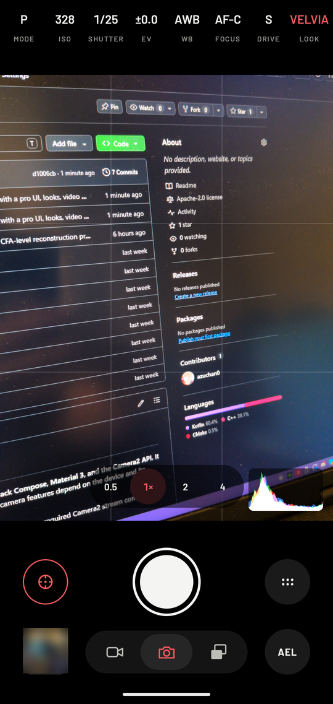

# Fabula

<p align="center">
  
</p>

Fabula is an Android camera app with a pro-camera interface, built with **Kotlin**, **Jetpack Compose** and the **Camera2 API**. It is developed for my Pixel 9a. Features the phone's camera does not expose are greyed out.

## Features

- **Photo** with drive modes: single, continuous low / high (hold the shutter) and self-timer.
- **48MP** — a RAW burst aligned and merged into an 8000 × 6000 reconstruction (2× the sensor's RAW resolution). This is a multi-frame prototype, not a native 48 MP capture.
- **Video** in 1080p with sound.
- **Pro controls** — ISO, shutter, exposure compensation, white balance and manual focus on a dial.
- **Colour looks** shown live in the viewfinder: Leica, Hasselblad, Fujifilm and Kodak-inspired renderings (Fabula's own approximations, not the manufacturers' profiles).
- **Zoom** from the 0.5× ultra-wide to 8×, RGB histogram, grid, exposure lock.
- **Gallery** of everything saved in `Pictures/Fabula` and `Movies/Fabula`.

## Project structure

- `:app` — Compose UI, settings, gallery, colour looks and the native (C++) RAW alignment, reconstruction and JPEG encoder.
- `:camera` — Camera2 preview, capture, RAW bursts, video and camera controls.

## Build

Open the project in Android Studio (with the NDK and CMake installed), or use the Gradle wrapper:

```bash
./gradlew :app:assembleDebug
```

Requires Android 14 or later (`minSdk 34`).

## License

Fabula is licensed under the [Apache License 2.0](LICENSE). The bundled Barlow typeface is licensed under the [SIL Open Font License 1.1](app/src/main/assets/licenses/Barlow-OFL.txt).
